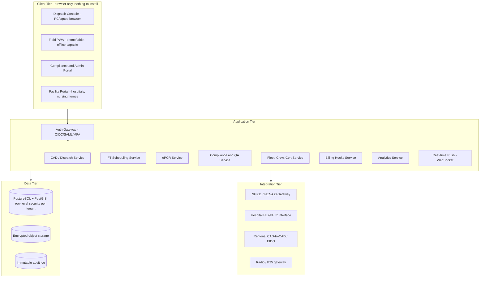

# EMS Dispatch & Operations Platform
## Master Plan & System Architecture

**Scope:** Deployable for any BLS/ALS ambulance service in the U.S.; NY (10 NYCRR Part 800 / FDNY / REMSCO-REMAC) as the reference implementation.
**Status:** Pre-build specification. Written to production standard — not an MVP-level sketch.

---

## Table of Contents
1. Executive Summary
2. What's Broken in Current Systems — and What Fixes It
3. Core Architecture
4. Core Data Model
5. Functional Modules
6. NY Regulatory Grounding (and How It Generalizes)
7. Security & Compliance Architecture
8. Non-Functional Requirements
9. Testing, Certification & Rollout
10. Phased Build Roadmap
11. Resourcing Reality Check
12. Open Assumptions & Next Steps

---

## 1. Executive Summary

This is a single operating platform for an EMS agency: call intake, dispatch, unit tracking, patient documentation, fleet/crew compliance, billing handoff, and regulatory reporting, built on **one incident record** instead of five disconnected systems that all describe the same call differently. Three design principles run through every module:

- **Zero re-entry.** Data typed once — at call intake — flows through to the ePCR, the billing export, and the compliance file. Nobody retypes what dispatch already captured.
- **Security and compliance are load-bearing, not decorative.** Access control, audit logging, and encryption are part of the data model from the first schema migration, not a checklist applied before a state audit.
- **Multi-tenant by default, mutual-aid-capable by design.** Any agency can run on this without seeing another agency's data — but when two tenants need to coordinate on a real incident, there's a governed, audited channel for that instead of a phone call.

One honest note up front: a **plan** at this level of rigor is genuinely deliverable in this format. A **certified, live system handling real patient data at a real company** is a multi-person, multi-year effort with legal, security-audit, and state-certification steps that no single document can shortcut. Section 10 lays out how to get from zero to a real working MVP without pretending the whole thing ships at once.

---

## 2. What's Broken in Current Systems — and What Fixes It

These are well-documented, industry-wide pain points, not a critique of any specific vendor or employer.

| Flaw in existing CAD/EMS software | Why it happens | How this platform fixes it |
|---|---|---|
| Dispatch, ePCR, billing, and scheduling are separate products from separate vendors | Historically built by different companies, integrated only loosely afterward | One incident record shared by every module — dispatch data pre-fills the chart, the chart pre-fills the billing export |
| Interfacility transport (dialysis runs, discharges, nursing-home transfers) is bolted onto a 911-first CAD as an afterthought | Most CAD vendors were built for public-safety 911 centers | IFT/standing-order scheduling is a **first-class core module** — for a private BLS/ALS operator this is usually the majority of call volume |
| Cross-agency mutual aid is coordinated by phone/radio even when both sides run "standards-compliant" CAD | NENA i3 conformance is inconsistently implemented across vendors, so nominally compatible systems still don't talk | Built to the NENA i3 / EIDO (Emergency Incident Data Object) data-exchange format from day one, with an actual conformance test suite instead of a checkbox |
| Field units lose functionality the moment connectivity drops | MDT software is often thin-client, server-dependent | Offline-first field PWA: local queue, full functionality without signal, automatic sync on reconnect |
| Built-in reporting is rigid; agencies export to Excel for real analysis | Reporting is usually an afterthought bolted onto the OLTP database | A real analytics/warehouse layer and ad-hoc report builder, so "pull the numbers" doesn't mean a CSV export and a pivot table |
| PHI exposure from shared dispatch-center monitors, weak audit trails, no real least-privilege model | Security retrofitted after the core product existed | RBAC, screen-privacy mode, and an immutable audit log are part of the schema from the start |
| Cert expirations, vehicle inspections, and controlled-substance logs tracked in spreadsheets | Fleet/crew compliance treated as HR's problem, not the CAD's | Automated tracking with hard scheduling blocks — a crew member with a lapsed cert or a vehicle past inspection literally cannot be dispatched |
| Vendor lock-in, slow release cycles, proprietary export formats | Legacy on-prem software, incentive to lock in customers | API-first, standard data formats (NEMSIS, HL7/FHIR, EIDO), full data export always available |
| EMS/ambulance companies are an active, current ransomware target | PHI + billing + SSNs in one record is high-value; 24/7 operational pressure makes agencies more likely to pay | Security architecture in Section 7 treats PHI compromise as the primary threat model, not an edge case — this is not hypothetical: NY-based Empress EMS, Acadian Ambulance, Bell Ambulance, and Fallon Ambulance have all had patient data stolen in ransomware attacks in the last few years |

---

## 3. Core Architecture

### 3.1 Why this isn't a GitHub Pages + Apps Script build

Your usual pattern — a static `index.html` on GitHub Pages talking to a Google Apps Script backend over JSONP — is a good, fast way to ship the tools in your build history. It's the wrong pattern for this one, for three specific reasons:

- **GitHub Pages is public by default.** Anything in the repo is visible to anyone with the URL. A system that has to guarantee PHI never leaks can't run on a host with no concept of a private, authenticated request.
- **Apps Script has hard quotas** — a 6-minute execution cap per call, daily execution limits, no persistent WebSocket connections. A dispatch board that has to reflect a unit going en route in under a second can't run on a platform built for scripted batch jobs.
- **JSONP isn't an auth boundary.** It's a CORS workaround, not a session or permission system. A HIPAA-scope system needs server-side authorization checked on every single request, not a script tag that happens to return JSON.

Everything else about how you like to build carries over: one browser-based front end, nothing to install to test it, a single URL that works from any PC. The difference is what's running behind that URL.

### 3.2 Recommended stack

| Layer | Recommendation | Why |
|---|---|---|
| Frontend | React + TypeScript, installable PWA | Works in any modern PC browser with zero install for testing; installable later for kiosk-mode dispatch consoles or offline field use |
| Backend | Node.js or Python (FastAPI), REST + WebSocket | WebSocket for real-time dispatch-board push (status changes, new calls) instead of polling |
| Database | PostgreSQL + PostGIS, row-level security | PostGIS handles response zones/routing geometry natively; RLS enforces tenant isolation at the database layer, not just the app layer |
| Object storage | Encrypted blob storage (signatures, photos, scanned forms) | Never store attachments in the relational DB directly |
| Hosting | AWS, Azure, or GCP — any of the three offer HIPAA-eligible services under a signed BAA | Don't self-host PHI infrastructure without a very good reason; these providers have already solved the compliance-eligible-infrastructure problem |
| Auth | OIDC/SAML2 SSO + native Azure AD/Entra ID and on-prem LDAP bridge | Given you already administer AD infrastructure, this is the one piece of the stack that's a direct extension of what you already run |
| Deployment | Containerized, infrastructure-as-code | Keeps you portable across cloud providers instead of locked into one |

### 3.3 Multi-tenancy vs. mutual aid — solving both at once

"Works for any company" and "no data leaked to people who shouldn't see it" sound like they pull against "agencies need to coordinate during real incidents" — they don't, if isolation and sharing are two different mechanisms:

- **Default state: hard isolation.** Every table is scoped by `tenant_id`, enforced by Postgres row-level security (not just application code — assume the app layer will eventually have a bug). Each tenant gets its own encryption key.
- **Opt-in state: a governed mutual-aid channel.** For a specific, declared incident, an authorized supervisor on each side can open a scoped, time-limited, fully audited data-sharing link between two tenants — visible only for that incident, logged with who opened it and who accessed what. This is what actually fixes the "mutual aid still happens over the phone" flaw without weakening isolation the rest of the time.

### 3.4 High-level diagram

---

## 4. Core Data Model

Not full schema — the entities and relationships that everything else hangs off of.

- **Tenant / Agency** — the company; holds its own regulatory profile (state, region, protocol set), encryption key, and configuration
- **User** — belongs to a tenant, has one or more Roles (see RBAC matrix, §7.3)
- **Incident** — the spine of the system. One record from first call to closeout; every module attaches to this
- **Unit** — a vehicle + crew pairing at a point in time; has live status, capability tags (BLS/ALS/bariatric/isolation), and location
- **Vehicle** — maintenance history, inspection status, equipment inventory
- **Crew Member** — links to certifications, current assignment, hours worked
- **Certification** — type, issuing body, expiration; drives the scheduling hard-block
- **ControlledSubstanceLog** — chain-of-custody entries, tied to Crew Member + Unit + Incident
- **PatientCareRecord** — the clinical chart; NEMSIS-schema-aligned; linked 1:1 to an Incident
- **TransportRequest** — the IFT/standing-order record: facility-to-facility, recurrence rule, requesting facility
- **Facility** — hospitals, nursing homes, dialysis centers; holds diversion/capacity status feed reference
- **ProtocolSet** — versioned, region-specific medical protocols (a REMAC revision creates a new version, doesn't overwrite the old one — you need the version that was active at time of care)
- **AuditLogEntry** — append-only; who viewed/edited/exported what, when, from where
- **BillingExport** — structured record ready for clearinghouse/payer submission

---

## 5. Functional Modules

### 5.1 Call Intake & EMD
- ANI/ALI ingestion where applicable; NG911/NENA i3-compatible intake for jurisdictions on Next Gen 911
- Configurable EMD protocol engine (MPDS/ProQA-style or a state-approved equivalent) with caller interrogation scripts and pre-arrival instructions
- Separate, equally first-class intake path for scheduled/on-demand IFT requests (see 5.3)

### 5.2 CAD Core / Unit Recommendation
- Live status board: available, en route, on scene, transporting, at destination, out of service — configurable labels (plain-language or code-based) per tenant
- Closest-appropriate-unit recommendation factoring live traffic, response zone, and capability match (BLS vs. ALS, bariatric, isolation) — always paired with one-click manual override, never a forced auto-dispatch
- AVL/GPS on every unit, sub-second push to the dispatch board over WebSocket

### 5.3 IFT / Non-Emergency Scheduling
- Standing-order/recurrence support (e.g., dialysis three times a week) with automatic re-generation
- Facility-submitted requests via the Facility Portal (5.12), with ETA visibility back to the requesting facility — removes a lot of the phone-tag that currently eats dispatcher time
- Medical-necessity documentation prompts at time of scheduling, feeding directly into the billing export

### 5.4 Mapping, Routing, GIS
- Turn-by-turn routing weighted for emergency-vehicle profiles, live traffic, known road closures
- Preplan data layer: hazmat notes, gate codes, building access notes per address
- Facility status board — diversion/bypass/capacity, wherever a regional feed exists to integrate against

### 5.5 Fleet, Crew & Credential Management
- Vehicle inspection/maintenance scheduling with compliance flags tied to state vehicle-construction and equipment requirements
- Certification tracking (EMT-B/AEMT/Paramedic, CPR/ACLS/PALS, DOT physicals) with expiration alerts **and a hard block** — a lapsed credential removes that person from the schedulable pool, full stop
- Controlled-substance chain-of-custody logging for ALS units
- Crew scheduling/roster with hours tracking

### 5.6 ePCR / Documentation
- Native ePCR sharing the same Incident record as dispatch — this is the single biggest fix for the industry's #1 documentation complaint (retyping dispatch data into the chart)
- NEMSIS v3.5.x-aligned data schema and export, built to be certifiable for "Collect Data" status with your state's data repository
- Open HL7/FHIR-based integration path for agencies that want to keep an existing ePCR vendor instead

### 5.7 Compliance & QA/QI
- Automated PCR completeness/quality scoring with deficiencies routed back to the crew for correction before final submission
- State-reporting automation: formatted exports for state Bureau of EMS submission, response-time compliance reporting against contract fractile targets (e.g., 90th percentile under X minutes)
- Investigation/incident-management workflow for QA review of adverse events and complaints, with regulatory citation fields built in
- Every PHI view/edit/export is captured in the immutable audit log automatically — this module doesn't have to ask for that data, it's already there

### 5.8 Billing / RCM Hooks
- Structured export/API to clearinghouse and billing systems
- Insurance eligibility check hooks; Medicare/Medicaid-compliant data capture (NY Medicaid/eMedNY as the reference integration) at point of transport

### 5.9 Interoperability Layer
- NG911/NENA i3 gateway using the EIDO (JSON) format for incident data exchange
- HL7v2/FHIR R4 interface for hospital ED pre-arrival notification
- Regional CAD-to-CAD exchange for the mutual-aid channel described in §3.3
- Open REST/webhook API for third-party integration; radio/P25 or push-to-talk-over-cellular gateway

### 5.10 Analytics & Reporting
- Configurable dashboards: response times, unit utilization, revenue per transport, cert-compliance %, QA scores
- Ad-hoc report builder and scheduled report delivery — the fix for "export to Excel to get a real answer"
- Data warehouse/BI export for agencies that want to plug in their own tools

### 5.11 Field/Mobile PWA
- Installable, offline-first: full functionality with no signal, local queue, sync on reconnect
- One-tap status updates, turn-by-turn handoff to native map apps, digital signature capture, barcode/QR scan for meds and equipment

### 5.12 Facility / Partner Portal
- Hospitals and nursing homes submit and track transport requests directly, see live ETA
- Optional public-facing status/API for municipal transparency reporting

---

## 6. NY Regulatory Grounding (and How It Generalizes)

This is the reference implementation's regulatory backbone. The platform encodes each of these as a **configurable regulatory profile** per tenant/region — so a Texas agency runs on Texas's EMS code instead of a rebuild.

- **10 NYCRR Part 800** (the State EMS Code, under Public Health Law Article 30/30A) governs certification, vehicle/equipment standards, controlled substances (10 NYCRR Part 80), and required conduct — this is the base rule set the compliance module's field validations are built against.
- **REMSCO/REMAC** — New York divides medical oversight regionally. The NYC Regional EMS Council and its Regional Emergency Medical Advisory Committee (whose membership includes FDNY, NYPD, GNYHA, hospitals, and ambulance agencies) issue and revise the protocols a Bronx-based operator practices under; SEMAC/SEMSCO does the same at the state level. This is exactly why `ProtocolSet` is versioned in the data model — REMAC issues protocol revisions on an ongoing basis, and a chart has to reflect the protocol version active on the date of care, not whatever's current when someone looks it up later.
- **NYC's ambulance sector structure** — coverage splits roughly between FDNY municipal units, hospital-based "voluntary" units, private interfacility transport, and volunteer corps. A private BLS/ALS operator's call volume is realistically dominated by the IFT sector rather than primary 911 response, which is exactly why §5.3 treats IFT scheduling as core rather than an add-on.
- **NEMSIS v3.5.x** — the national EMS data standard your state submission ultimately has to conform to; agencies typically can't revert to an older version once they start submitting on a new one, so the ePCR schema needs to track NEMSIS releases deliberately, not reactively.
- **Record retention** — patient care records generally need to be kept 6 years, or 3 years past the patient's 18th birthday, whichever is longer; billing-inclusive records commonly run 7 years; controlled-substance records around 5 years. These figures get revised periodically and differ for privately owned vs. municipal agencies — treat what's above as the design target for the retention/disposal engine, and confirm the current exact figures against your own compliance function before locking them in as hard rules (I'm not a lawyer, and you're better positioned than I am to verify this one).

---

## 7. Security & Compliance Architecture

### 7.1 The threat model is not hypothetical

EMS and ambulance companies have been an active ransomware target in recent years, with real incidents resulting in stolen patient data — a New York ambulance provider (Empress EMS) had names, insurance details, and Social Security numbers exposed after a 2022 ransomware attack; Acadian Ambulance faced a $7 million ransom demand in 2024; Bell Ambulance and Fallon Ambulance both disclosed similar breaches in the years since. PHI plus billing data plus SSNs in one record, combined with the operational pressure of a company that can't afford downtime, makes this sector a specifically attractive target — not an edge case to plan for eventually.

### 7.2 Where HIPAA is heading (build to this now)

The current HIPAA Security Rule still allows some safeguards to be merely "addressable" rather than mandatory. That's changing: HHS proposed a significant Security Rule overhaul in January 2025 that would make encryption of ePHI mandatory (not addressable), require MFA on every system touching ePHI, mandate a 72-hour breach-reporting window, and require annual penetration testing. **As of today, this rule is still proposed, not final** — HHS's own timeline has slipped, with final action now targeted for mid-2027, and it could still change before then. But its direction is a clear signal: build to the stricter standard now rather than retrofitting under a compliance deadline later.

### 7.3 Role-based access — least privilege by default

| Role | Sees live incidents | Sees historical PHI | Edits protocols/config | Sees billing data | Audit log access |
|---|---|---|---|---|---|
| Dispatcher | Yes | No (active incident only) | No | No | No |
| Crew/Medic | Own assigned incidents | Own patient charts | No | No | No |
| Supervisor | Yes | Yes, own agency | No | No | No |
| Compliance Officer | Yes | Yes, own agency | Protocol versions only | No | Yes |
| Biller | No | Billing-relevant fields only | No | Yes | No |
| IT Admin | No | No | System config only, not PHI | No | Yes (system-level) |
| Read-only Auditor | No | Yes, scoped to audit period | No | No | Yes |

### 7.4 Technical controls
- TLS 1.3 in transit; AES-256 at rest; field-level encryption on SSNs and other high-sensitivity fields; encrypted backups
- SSO via OIDC/SAML2, native Azure AD/Entra ID and on-prem LDAP bridge, MFA (FIDO2/WebAuthn preferred) enforced on every privileged role
- Auto-logoff on idle; a screen-privacy mode for shared dispatch-center monitors — a real, common HIPAA exposure point that's usually ignored
- Immutable, hash-chained audit log — satisfies the HIPAA audit-controls requirement and can't be quietly edited after the fact
- Row-level security plus per-tenant encryption keys for isolation — defense in depth, not just an application-layer promise
- Signed BAAs with every cloud vendor and sub-processor that could touch PHI

### 7.5 Ongoing assurance
- Third-party penetration testing on a recurring cadence (annual at minimum, matching the direction of the proposed rule above)
- Dependency/vulnerability scanning in CI
- SOC 2 Type II as a target, not a someday-maybe
- A documented, rehearsed incident response and breach-notification plan

---

## 8. Non-Functional Requirements

| Requirement | Target |
|---|---|
| Dispatch-board update latency | Sub-second from status change to all connected consoles |
| Uptime | 99.99% for the CAD core (this is a life-safety system — treat downtime like an outage report, not a metric) |
| Disaster recovery RPO/RTO | Minutes, not hours — multi-region data replication |
| Offline field operation | Full functionality with no signal; queued sync on reconnect |
| Concurrent tenants | Architected for many from day one, even if the first real deployment is one agency |

---

## 9. Testing, Certification & Rollout

- **Never a hard cutover.** Run in parallel against whatever the agency uses today for at least one full billing/reporting cycle before switching over.
- **Pilot with one shift or unit group first**, not the whole operation.
- **NEMSIS certification** — get the ePCR schema formally certified to "Collect Data" status for the version you're submitting; remember agencies generally can't revert to an older version once they've started submitting on a new one.
- **Independent security review before any real PHI touches the system** — penetration test plus a SOC 2 readiness assessment, not a self-assessment.
- **UAT with actual dispatchers and crews**, not just engineers — the people who'll spend a 12-hour shift in this UI need to sign off on it, not just the people who built it.

---

## 10. Phased Build Roadmap

| Phase | Scope | Realistic builder |
|---|---|---|
| **0 — MVP** | Single tenant, call intake, live status board, IFT scheduling, a basic ePCR record, basic audit log | Solo-buildable — squarely in line with what you've already shipped independently |
| **1** | Crew/cert/vehicle compliance module with hard scheduling blocks, hospital pre-notification, mapping/routing | Still solo-feasible, more time |
| **2** | Multi-tenant conversion, full RBAC maturity, billing hooks, analytics/reporting layer | Benefits from a second set of hands, especially on the tenant-isolation work |
| **3** | NG911/EIDO interoperability, SOC 2 process, alignment with the proposed HIPAA Security Rule, independent security review | This is where it stops being a side project and starts needing a real security/compliance sign-off before any real patient data touches it |

---

## 11. Resourcing Reality Check

Building through a working MVP demo (Phase 0, arguably Phase 1) is realistically something one capable builder can do — your track record of shipping real, working solo tools backs that up. **Going live with real patient data at a real company is a different commitment**: at minimum, an independent security review before go-live, and ideally a small team where someone owns security/compliance mapping full-time — which, not incidentally, is a role you already hold. This isn't a reason not to build it. It's the honest line between "impressive working demo" and "system a state auditor signs off on."

---

## 12. Open Assumptions & Next Steps

Assumptions made in this plan, flagged so they're easy to correct:
- Treated as a genuine multi-tenant SaaS platform (since you said "any company"), with your own operation as the natural first/reference tenant rather than the only one
- Treated NY/Bronx as the regulatory reference implementation, with other states handled via the configurable regulatory-profile pattern in §6
- Assumed IFT is the dominant call type for a private BLS/ALS operator in NYC, based on how the city's 911 ambulance sectors are structured — worth confirming against your own call-volume mix

Natural next steps, any of which I can build out from here:
- The actual database schema (DDL) for the entities in Section 4
- A working UI prototype of the dispatch console or the field PWA
- A deeper spec on any single module — the compliance/QA engine is the one that maps most directly onto what you already do day-to-day
